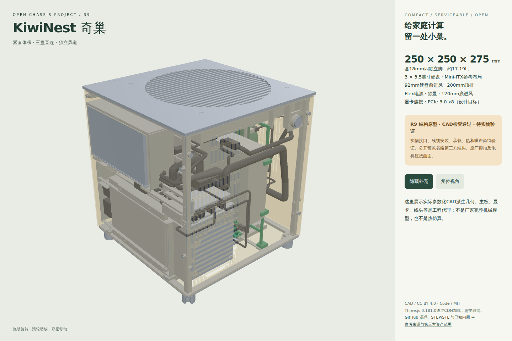

# KiwiNest

A compact home-server chassis that gives three 3.5-inch drives their own cooling path. The R9 layout adds a dedicated 92mm front fan, four passages across the drive faces and a sealed collector feeding a 200mm top exhaust. The motherboard, GPU, complete x8 riser endpoints and 40mm CPU clearance datum stay fixed.

[中文说明](README.md) · [Interactive model](https://ericxreator.github.io/kiwinest/) · [Downloads](https://github.com/ericxreator/kiwinest/releases) · [Design](docs/design.md) · [Known issues](docs/known-issues.md)



**The R9 `v0.4.0-r9` prototype has passed its recorded CAD and public-geometry checks. Physical and manufacturing acceptance remain pending.** Validation combines a 39-group assembly baseline rebuilt from manufacturer STEP inputs, 23 focused checks after a local plenum-floor correction, and regeneration of all exports. The 41 final records consist of 39 baseline groups, one focused revalidation summary and one export-integrity record; all are clear. All 43 printable CAD items have closed meshes with consistent winding, and STEP readback validates 782/782 solids. The local correction was not followed by another complete assembly rebuild. See the [actual report](evidence/current-review.json) and [publication record](evidence/publication-verification.json). CAD passages do not establish installed airflow, drive temperatures or negotiated PCIe lanes.

| Item | R9 reference layout |
| --- | --- |
| Size | 250 × 250 × 257mm body plus four 18mm feet; 250 × 250 × 275mm overall envelope, approximately 17.19L |
| Drives | Three independent SATA drives, rear-facing connectors, four native 6-32 screws per drive, no backplane |
| Drive cooling | 92mm front fan, distribution plenum, four broad-face passages, rear collector and top diffuser |
| Passages | Nominal widths 5 / 7 / 7 / 5mm with 82mm continuous height; native mounting bands sit above and below |
| Top fan | Noctua NF-A20 PWM, 200 × 200 × 30mm housing without removable anti-vibration pads; motor-label projection retained |
| Other airflow | 120mm bottom intake, CPU side intake, separate GPU supply; bottom filter withdraws to the right |
| PSU | Original fixed-wire Enhance ENP-7660B rolled 90°; AC socket and exhaust remain directly rear-facing; known louvered side opens to exterior air |
| Board / GPU | DS_2501 / Ryzen 7 5825U photo-derived board reference; Zotac ZT-B50620H-10M GPU envelope |
| Riser | K83UP-TL 50cm, complete original endpoints and cable material; target PCIe 3.0 x8, hardware negotiation unverified |

After subtracting the projected stationary manufacturer fan frame, the conservative geometric diffuser mouth is approximately 2192.51mm², above the four main passages' combined 1968mm²; see the [top-fan verification](evidence/top-fan-verification.json). The front inlet currently has a grille. The removable filter is under the bottom fan; this does not make the front inlet filtered. Passage dimensions and connectivity remain distinct from pressure drop, sealing, dust loading and thermal tests.

The front fan and plenum come out in separate stages while the upper front-left column, hub and stock-cable basket remain installed. Drive service requires power-off, removal of the target power and data access shutters, one panel at a time, unplugging and parking only that drive's two heads/tails, then releasing its tray. Drive 1 additionally needs the removable lower column segment to move forward. Open cable slots and removable seals avoid threading finished connectors through closed holes. See the [assembly notes](docs/design.md); hot-swap capability is unverified.

The complete bottom-fan PWM coupling sits to the right of the plenum extraction path. The factory fan lead and final SYS extension span route around the tray-lock L-key envelope, with their complete heads and wire runs retained for service checks. Actual tools and hand access still require fit-up.

All original factory branches and purchased cable surplus remain accounted for. The 32 complete power, data and PWM route budgets include centerline, connector allowances and assembly slack; their minimum remaining length is 25.434mm against R9's 25mm requirement. These are engineering budgets; received cable lengths remain unverified. Unused EPS-half/Molex/FDD stock and loose surplus remain stock-volume allocations, rather than individually measured conductor or coil geometry. Shared free volume does not prove that real coils fit or remain serviceable.

Use Python 3.13 and the locked dependencies:

```sh
python3.13 -m venv .venv
. .venv/bin/activate
pip install -r requirements.lock
python scripts/prepare_references.py
python design/r9_export.py --out-dir out-r9
python scripts/build_public_assets.py --input out-r9
python scripts/build_public_bom.py --input out-r9/report.json
```

The optional top-fan verifier accepts an independently obtained [official Noctua STEP](references/README.md#风扇参考) and outputs numeric evidence only. Install `shapely==2.1.2`, supply its local path and bind the result to the passed R9 report:

```sh
pip install shapely==2.1.2
python scripts/verify_top_fan.py --official-step /path/to/NF-A20_Public-CAD.stp --source-report out-r9/report.json --output evidence/top-fan-verification.json
```

Original printable STEP/STL files are in [`cad/parts/`](cad/parts/). Thin PC sheet, foam, FR4, steel washers and the PSU metal flange are separate fabrication items; see [CAD notes](cad/README.md) and [`bom/`](bom/). Open [`docs/preview.html`](docs/preview.html) for the model; pinned Three.js modules require a network connection.

Full local outputs contain independently downloaded manufacturer references and are not public release assets. Public GLB/HTML omits both manufacturer riser endpoints and the vendor-derived compressed foam surface, including unused binary data. Public foam fabrication instead uses an independent flat blank. Noctua manufacturer CAD stays local to proxy/clearance verification. These omissions never establish physical compatibility. See [third-party references](THIRD_PARTY.md).

Received board dimensions, factory loom exits, connector fit, usable cable lengths, surplus packing, printed load/creep, insulation, PCIe power/link stability, per-drive temperature and noise still require real hardware. Earlier releases remain available: [R8](https://github.com/ericxreator/kiwinest/releases/tag/v0.3.0-r8), [R7](https://github.com/ericxreator/kiwinest/releases/tag/v0.2.0-r7), [R6](https://github.com/ericxreator/kiwinest/releases/tag/v0.1.0-r6).

Inspired by [QNAS7](https://github.com/thunder439/QNAS7) / [QNAS8](https://github.com/thunder439/QNAS8); their files are not redistributed. Original code: MIT. Original CAD/design data: CC BY 4.0. Copyright © 2026 ericxreator. See [license scope](LICENSES/README.md).
