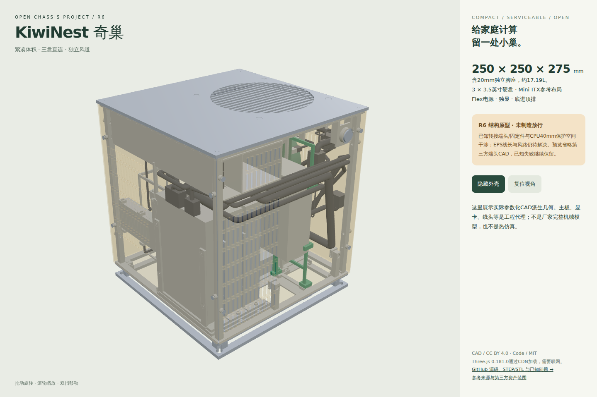

# KiwiNest

A compact, parametric three-drive home-server chassis: 250 × 250 × 275mm including feet, approximately 17.19L. Mini-ITX reference board, discrete GPU, fixed-wire Flex PSU, direct SATA cabling and independent bottom-to-top cooling.

**R6 is an engineering prototype. Geometry checks fail; manufacturing and physical/thermal acceptance are incomplete.** The R83SL riser endpoint and mounting hardware interfere with the protected 40mm CPU envelope. The factory EPS300mm lead is also too short for the complete planned route. Do not treat the models as a ready-to-print or procurement release.

- [Download STEP/STL and source](https://github.com/ericxreator/kiwinest/releases)
- [View the interactive model online](https://ericxreator.github.io/kiwinest/)
- 40 original chassis parts in [`cad/parts/`](cad/parts/), plus a separate sheet-metal PSU flange.
- Download and open [`docs/preview.html`](docs/preview.html) for the interactive CAD viewer. It needs an internet connection for pinned Three.js modules.
- Original source: [`design/`](design/). Parts lists: [`bom/`](bom/). Preserved failures: [`evidence/r6-review.json`](evidence/r6-review.json).

For a local rebuild, use Python 3.13 and install `requirements.lock`, run `python scripts/prepare_references.py`, then `python design/r6_export.py`. Manufacturer references are checksum-verified and kept in the ignored `references/private/` directory. Local full-assembly outputs contain those references and are not distributable project artifacts.

Public previews omit the two manufacturer connector models, including their unused binary data. This omission never changes the original failed checks. Component proxies are planning references, not manufacturer mechanical CAD or compatibility certification.

Inspired by [QNAS7](https://github.com/thunder439/QNAS7) / [QNAS8](https://github.com/thunder439/QNAS8); their files are not redistributed. See [third-party sources](THIRD_PARTY.md), [known issues](docs/known-issues.md), and the [Chinese documentation](README.md) for dimensions and service procedures.

Original source code: MIT. Original CAD and design documentation: CC BY 4.0. Copyright © 2026 ericxreator. See [`LICENSES/README.md`](LICENSES/README.md) for scope.
