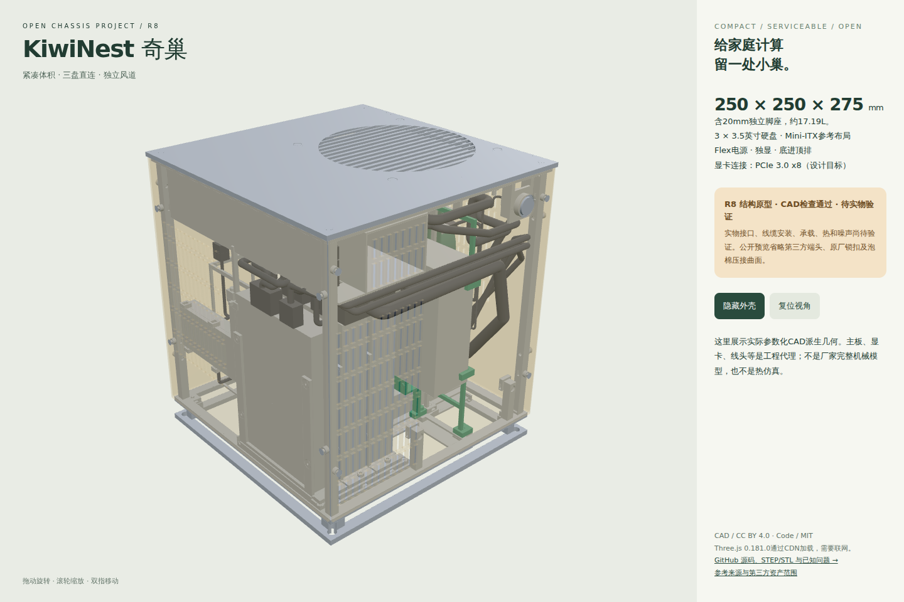

# KiwiNest · 奇巢

**一台给家庭计算留空间的紧凑三盘机箱。**

[English](README.en.md) · [在线 3D 预览](https://ericxreator.github.io/kiwinest/) · [下载当前原型](https://github.com/ericxreator/kiwinest/releases) · [设计说明](docs/design.md) · [已知问题](docs/known-issues.md)



KiwiNest 把三块 3.5 英寸硬盘、Mini-ITX 参考主板、独显和 Flex 电源放进约 17.19L 的立式机身。硬盘独立 SATA 直连，机箱依靠自身进排风散热，外壳、托架与固定件以 CadQuery 参数化构造。

**当前为`v0.3.0-r8`工程原型：完整模型通过25组CAD检查，实物与制造仍未放行。** 设计保持现有5825U主板、CPU40mm保护和显卡x8电气链路，采用商业K83UP-TL端头与原创绝缘夹持件。公端及安装件对CPU40保护体的最小名义净距为2.311mm。ATX电源面至出线点的过渡已纳入完整曲线和分体实体通道；22段电源、PWM/控制及SATA完整预算均剩余至少20mm，最小21.770mm，并将新增延长线的全部余线计入共享收纳体积。检查范围与受控接触见[当前检查报告](evidence/current-review.json)和[R8说明](docs/r8-changes.md)。R6/R7分别保留在`v0.1.0-r6`/`v0.2.0-r7`标签。

完整STEP回读为731/731有效实体，40/40打印网格闭合；公开几何字节审计和桌面/手机视口浏览器检查通过。PCIe x8束线在底扇圆域的几何投影约9.3943%，不代表风量损失、压降或散热验收。验证范围见[发布检查](evidence/publication-verification.json)，手机检查仅为浏览器视口模拟。

原型尚未完成实板尺寸、收到的线缆、PCIe供电/协商/稳定性、自制夹持件载荷、打印承载和热/噪声验收。完整ATX过渡CAD不表示原厂出口坐标已测量；这些坐标仍为工程假设。SATA原厂A/B首段各另留10.5mm未建模出口长度，尚未证明其源段隔离，不能套用ATX的完整过渡结论。CAD检查与制造放行分别记录。

## 主要规格

| 项目 | R8 参考布局 |
| --- | --- |
| 外尺寸 | 主体 250 × 250 × 255mm；含 20mm 独立脚座总高 275mm |
| 主板 | 170 × 170mm DS_2501 / Ryzen 7 5825U 参考板；接口位置来自照片估计，不能等同通用兼容认证 |
| CPU 空间 | 元件面向外硬留 40mm；不压缩保护空间来掩盖转接端头干涉 |
| 硬盘 | 3 × 3.5 英寸，独立数据线与成品电源原厂供电线，无背板 |
| GPU | 以 Zotac ZT-B50620H-10M / RTX 5060 Ti 16GB 的 220.5 × 120.25 × 41.6mm 包络为参考 |
| 电源 | Enhance ENP-7660B原厂固定线Flex；标准端延长，不改PSU内部接线；真实出口/可用线长待实配 |
| 显卡转接 | K83UP-TL定制50cm：464mm自由线束加两端共36mm套管，FR4/绝缘硅胶泡棉夹持；目标PCIe3.0 x8，实机协商待验 |
| 风路 | 120mm 底进、140mm 顶排、CPU 侧进风、PSU 独立前进后出 |
| 打印基线 | 256 × 256 × 256mm 构建空间；装配公差、材料、蠕变和承载待实测 |

这套布局针对明确的部件组合，更换显卡、主板或电源后需要重新检查。风路模型仅表达空间安排，没有 CFD 或温升结论。

旧R83前耳及前固定螺钉侵入CPU40mm空间，冲突来自具体外形与方向，x8通道数本身不是机械障碍。R8保留厂家PCB、触点、完整扇出和上夹条，使用原创FR4/绝缘硅胶泡棉下夹持件替换下夹条及前M2，由头朝下、轴朝上的原厂中/后M2在台面预装夹紧。同时对主板2/4号下位安装点使用两片原创OD9 × 1.5mm钢制沉头承载垫及两颗M3x8沉头螺钉，保持板柱基准和调整孔；完整PCB避让已作几何核对，载荷与公差仍须实测。夹持结构和实物门槛见[R8说明](docs/r8-changes.md)。

泡棉原片厚1.5mm，仅裁外形及两孔；公开提供独立生成的平片STEP/DXF。名义1.4mm受压贴合曲面含厂商来源几何，仅用于本地检查，不是沿线束曲面铣槽的加工图。检查允许该泡棉的局部受控压接，不能把通过解释为所有接触体积均为零；压缩、预紧和回弹未实测。原厂M2仅沿轴向拧入约0.400mm，CAD上夹条的2.2mm孔未建牙，实际扣持和进入量待验。公端维护须先释放支架和束线约束、整体移出后再操作夹持螺钉；在位工具空间及组合完整移出路径尚未验证。

原厂完整锁扣须可逆拆下，固定在一体桥的保管夹内，以M2x25横销和捕获M2螺母保持；厂家锁扣材料全部保留。GPU由I/O耳、导轨和上夹保持，需要改造装配，不能称原厂直接装入。实际拆件、保持力、承载和链路均未验收。464mm自由线束已完整建模，其中约49.213mm为相对同一路由族紧凑参考的几何回环分配，真实可用余量仍须实配。

GPU拆卸前须断电、拆顶盖/顶扇，拔下并停放卡端8pin插头与自由延长段，再拆夹具、脱槽上提。原厂300mm主线和中转头已移到显卡上拔区之外，删除R7将原厂线前移停放的要求；实际软线变形、保持力和操作顺序仍待实配。

## 文件和查看方式

- [`cad/parts/`](cad/parts/)：原创机箱打印件，各提供STEP与STL；FR4压条、绝缘硅胶泡棉、自制钢承载垫和金属法兰按[CAD说明](cad/README.md)及BOM另制。
- [`cad/PSU-flange-1mm-REVIEW.dxf`](cad/PSU-flange-1mm-REVIEW.dxf)：1mm 金属电源法兰，另附 STEP；**不是打印件**。
- [`cad/kiwinest-public.glb`](cad/kiwinest-public.glb)：原创箱体、五金和线缆工程代理的装配预览。
- [`docs/preview.html`](docs/preview.html)：下载后在浏览器打开，可旋转、缩放和隐藏外壳；Three.js 通过固定版本 CDN 加载，需要联网。
- [`bom/`](bom/)：部件选型、五金、打印件清单；未知容量、数量、价格不补造。
- [`design/`](design/)：完整当前 参数化构造与导出入口，旧版辅助模块仅保留使用的函数。
- [`evidence/current-review.json`](evidence/current-review.json)：当前真实检查结果、完整线长预算、零件指标与来源报告 SHA-256。

公开装配省略两个ADT-Link原厂端头和含厂商来源几何的泡棉受压曲面，连同它们未引用的二进制数据，共三个节点。泡棉另提供原创1.5mm平片STEP/DXF。整机检查使用包含真实原厂端头和受压代理的本地模型；公开预览的省略不能用来掩盖碰撞或判定通过。厂商图纸、原始照片与QNAS模型没有随仓库分发，详见 [来源说明](THIRD_PARTY.md)。

## 本地重建

已验证的源环境是 Python 3.13.13、CadQuery 2.8.0。完整冻结依赖见 `requirements.lock`；`requirements.txt` 列出直接依赖。

```sh
python3.13 -m venv .venv
. .venv/bin/activate
pip install -r requirements.lock
python scripts/prepare_references.py
python design/r6_export.py --out-dir out-r8
```

准备脚本从原厂下载固定 SHA-256 的参考输入，仅写入 Git 忽略的 `references/private/`。原厂地址内容变化时停止，须重新审查。也支持经同样校验的离线文件，见 [`references/README.md`](references/README.md)。

源模块沿用`r6_`文件名；当前版本以参数中的`release_revision`为准。`out-r8/`是包含原厂输入几何的**本地审阅输出**，不会自动成为公开产物。导出成功、STEP 回读通过与打印网格闭合，不代表碰撞、实际装配或制造通过。需要生成本项目相同边界的公开资产时，再运行：

```sh
python scripts/build_public_assets.py --input out-r8
python scripts/build_public_bom.py --input out-r8/report.json
python scripts/airflow_projection.py --cables-dir out-r8/cables --pattern 'CABLE_R8_K83*.step' --output evidence/airflow-current.json
```

当前发布的实际验证范围见 [`evidence/publication-verification.json`](evidence/publication-verification.json)。几何检查、STEP回读、打印网格与浏览器验收分别记录，实物/热验证保持独立状态。

## 参与改进

欢迎通过 Issue / PR 反馈实板测量、线缆与打印试装结果，继续改进余线收纳和维护结构。提交时请附参数、部件版本、检查结果，并分别说明 CAD 检查和实物测试。当前优先事项见 [已知问题](docs/known-issues.md)。

结构思路参考了 [thunder439/QNAS7](https://github.com/thunder439/QNAS7) 和 [QNAS8](https://github.com/thunder439/QNAS8)，感谢原作者的工作；本仓库发布的是重新参数化构造的原创零件与代码，参考资产的权利与许可范围见 [THIRD_PARTY.md](THIRD_PARTY.md)。

## 许可证

Copyright © 2026 [ericxreator](https://github.com/ericxreator)。

- 原创 Python、HTML/JavaScript 源码：**MIT**，见 [`LICENSE`](LICENSE)。
- 原创 CAD、网格、设计说明、截图及工程数据：**CC BY 4.0**，见 [`LICENSES/CC-BY-4.0.txt`](LICENSES/CC-BY-4.0.txt)。

使用或修改 CAD 时保留作者和项目链接，并说明改动。项目许可证不涵盖独立获取的第三方材料；完整文件范围见 [`LICENSES/README.md`](LICENSES/README.md)。
